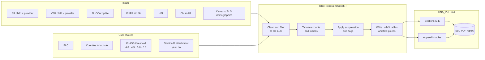

<div align="center">

# Florida Community Needs Assessment (CNA)
### Technical Appendix & Supporting Documentation

**Early Childhood Policy Research Group (ECPRG)** · **UF Anita Zucker Center for Excellence in Early Childhood Studies**
in partnership with the **Florida Division of Early Learning (DEL)**

[](https://ufl.qualtrics.com/jfe/form/SV_emnNaO06r1S7HKe)
[](#1-technical-appendix)
[](#2-pelican-bay-simulated-datasets)

</div>

> [!NOTE]
> **Temporary home.** This repository is currently hosted at
> [github.com/zenit125/CNATechnicalAppendix](https://github.com/zenit125/CNATechnicalAppendix).
> It will move to a dedicated CNA account (e.g., `CNAFeedback@UFL.edu`). Links will be updated when that happens.

---

## Contents

- [About this space](#about-this-space)
- [1. Technical appendix](#1-technical-appendix)
- [2. Pelican Bay simulated datasets](#2-pelican-bay-simulated-datasets)
- [3. How the CNA code works](#3-how-the-cna-code-works)
- [4. Data dictionaries and technical reports](#4-data-dictionaries-and-technical-reports)
- [Repository layout](#repository-layout)
- [Feedback and contact](#feedback-and-contact)

---

## About this space

Florida's 30 Early Learning Coalitions (ELCs) each receive a standardized **Community Needs Assessment (CNA)** report. The report gives every coalition the same statewide baseline on demographics, School Readiness (SR), Voluntary Prekindergarten (VPK), access to high-quality care, and affordability.

The reports are meant to be read without opening this repository. This space holds the **supplementary and technical detail** behind them:

- where each number comes from and what it covers
- how each table and index is calculated
- the code that builds the reports, so the work can be checked and replicated
- a fictional example coalition you can use to explore a report without real data

**Found an issue, or have a question or idea about your CNA?**
👉 **[Share it through the CNA feedback survey](https://ufl.qualtrics.com/jfe/form/SV_emnNaO06r1S7HKe)**

---

## 1. Technical appendix

📁 [`technical-appendix/`](./technical-appendix/)

### Purpose

The technical appendix documents every reporting element in the CNA. It is written for two audiences:

| If you are… | Start with… |
|---|---|
| **ELC staff, board members or partners** who want to know what a table means, where it comes from, or why a number looks the way it does | The plain-language description at the top of each element |
| **Data and research staff** who want to verify, replicate or extend the analysis | The data source, delimitation and code sections for each element |

### What each element includes

| Section | What you'll find |
|---|---|
| **Description** | What the table, figure or index shows and how to read it |
| **Data source and origin** | The source system or agency, the dataset, the date retrieved, and the file it comes from |
| **Delimitations** | Reporting periods, inclusion and exclusion rules, suppression rules, and known limits |
| **Calculation** | Formulas and steps in plain language (e.g., *Infrastructure = high-quality capacity − high-quality enrollment − not-high-quality enrollment*) |
| **Code for replication** | A link to the exact R function or code block that produces the element |

### Key delimitations at a glance

> [!IMPORTANT]
> The items below are a summary. Confirm against the full appendix before citing.
> Items marked `[confirm]` are placeholders for the team to finalize.

| Topic | Rule |
|---|---|
| SR reporting period | State fiscal year 2024–25 (July 1, 2024 – June 30, 2025) `[confirm]` |
| VPK reporting period | 2024–25 school-year VPK; summer VPK excluded `[confirm]` |
| Kindergarten comparison | 2025–26 kindergarten enrollment `[confirm]` |
| Program assessment (CLASS) scores | 2024–25 SR composite scores; providers without a score are never counted as high quality |
| High-quality thresholds | CLASS 4.0, 4.5, 5.0 and 6.0. The reports use 5.0 by default |
| Geography | Children and providers are counted by **provider** location unless noted; zip codes that cross county lines are handled as described in the appendix |
| Excluded providers | `[confirm: e.g., school-district VPK sites, out-of-area providers]` |
| Child counts | Distinct children over the reporting period, not a monthly average |
| Small-number suppression | HPI cells with fewer than 10 households; subgroup zip codes with fewer than 15 children |
| Demographic estimates | U.S. Census Bureau American Community Survey 5-year estimates `[confirm years]` |

### Get the appendix

- 📄 [Technical Appendix (PDF)](./technical-appendix/CNA_Technical_Appendix.pdf) `[placeholder]`
- 📝 [Technical Appendix (Word, for editing)](./technical-appendix/CNA_Technical_Appendix.docx) `[placeholder]`
- ♿ [Accessibility Appendix](./technical-appendix/CNA_Accessibility_Appendix.pdf) `[placeholder]`
- 💬 [Give feedback on the appendix](https://ufl.qualtrics.com/jfe/form/SV_emnNaO06r1S7HKe)

---

## 2. Pelican Bay simulated datasets

📁 [`simulated-data/pelican-bay/`](./simulated-data/pelican-bay/)

> [!WARNING]
> **Pelican Bay is fictional.** Every name, zip code, provider and number in these files is invented.
> They contain no real child, family or provider information.

### Purpose

The **ELC of Pelican Bay** is a made-up, three-county coalition. Its datasets have the same layout as the real files DEL provides. Use them to:

- see what each input looks like before you open a real report
- follow a single number from the raw file through to the finished table
- run the report code end to end without access to protected data
- test data-quality checks

### The fictional geography

| Coalition | Counties | Notes |
|---|---|---|
| **ELC of Pelican Bay** | Heron, Osprey, Egret | One zip code (90118) is split between Heron and Osprey; Egret zips start with `0` |
| ELC of Gator Ridge (neighbor) | Cypress | Some Pelican Bay children attend providers here |
| ELC of Sandhill (neighbor) | Palmetto | Same |
| 27 other placeholder ELCs | "County 06" – "County 67" | Appear only in statewide comparison rows |

### The datasets

| File | One row per | What it represents | Real-world source |
|---|---|---|---|
| `SR_child_by_provider.csv` | Child × provider | Children in School Readiness, their providers, home and provider locations, paying ELC and priority-subgroup flags | DEL child-level SR enrollment and attendance |
| `VPK_child_by_provider.csv` | Child × provider | Children in school-year VPK, their providers and VPK hours | DEL child-level VPK enrollment and attendance |
| `Zip_FLICCA_SR.csv` | Provider zip × county | SR capacity and enrollment by quality threshold → **FLICCA** index | DEL provider data, DCF licensing capacity and program assessment (CLASS) scores |
| `Zip_FLIPA_VPK.csv` | Provider zip × county | VPK capacity and enrollment by quality threshold → **FLIPA** index | Same as above for VPK |
| `HPI.csv` | State, ELC, county or home zip | Household Price Index (share of household income spent on care) by number of children | DEL SR family records (income, copay, provider rates) |
| `ChurnFill.csv` | Coalition | Children entering and leaving SR, the enrollment replacement ratio, and average spending | DEL SR enrollment and expenditure records |

Two versions are included:

- **`clean/`** — every file agrees with every other file
- **`with_errors/`** — the same files with 12 planted errors and a list of what each one is, for practicing data checks

### How the data become a report



In words:

1. **Pick the report settings:** the ELC, which counties to include (all, or one county), the high-quality threshold (CLASS 5.0 by default), and whether Section D has an attachment.
2. **Filter** each dataset to that ELC and its counties.
3. **Tabulate:** counts of children and providers, FLICCA and FLIPA by zip and subgroup, VPK hours and performance, HPI and the enrollment replacement ratio.
4. **Protect and flag:** suppress small cells and mark HPI values above the state (`*`) or coalition (`†`) average.
5. **Assemble:** the tables and generated sentences are placed into Sections A–E and the appendix, then rendered to PDF.

---

## 3. How the CNA code works

📁 [`code/`](./code/)

The reports are built in **R**, with **R Markdown** and **LaTeX** for the PDF layout. Three scripts run in order:

| Step | Script | What it does | Output |
|---|---|---|---|
| 1 | [`TableProcessingScript.R`](./code/TableProcessingScript.R) | Reads the input files, cleans names and zip codes, filters to each ELC, calculates every table and index, applies suppression and flags, and writes the generated summary sentences | One set of LaTeX tables (`.tex`) and text objects (`.rds`) per ELC |
| 2 | [`CNA_PDF.rmd`](./code/CNA_PDF.rmd) | A parameterized report template. Pulls in one ELC's tables and text, numbers tables and cross-references, and lays out Sections A–E and the appendix | One ELC report (`.pdf`) |
| 3 | [`GeneratePDFs.R`](./code/GeneratePDFs.R) | Loops over all 30 ELCs (and county options), passes the settings to `CNA_PDF.rmd`, and names each file | All reports, e.g. `CNA_ELC_<Name>_AllCounties_500_SectionDAppendix.pdf` |

### Report file names

```
CNA_ELC_<ELC name>_<Counties>_<Threshold>_<Section D option>.pdf
                     │            │           └─ SectionDAppendix = with attachment page
                     │            └─ 500 = CLASS 5.00 (400, 450, 600 also possible)
                     └─ AllCounties or a single county
```

### Running it yourself

```r
# 1. Install the packages
install.packages(c("dplyr", "tidyr", "readr", "stringr", "knitr",
                   "kableExtra", "rmarkdown"))   # [confirm full list]

# 2. Point the scripts at the example data
data_dir <- "simulated-data/pelican-bay/clean"

# 3. Build tables, then render one report
source("code/TableProcessingScript.R")
rmarkdown::render("code/CNA_PDF.rmd",
                  params = list(elc = "ELC of Pelican Bay",
                                counties = "AllCounties",
                                threshold = "500",
                                section_d_appendix = TRUE))  # [confirm parameter names]
```

> [!TIP]
> Rendering a PDF needs a LaTeX installation. The simplest option is
> `install.packages("tinytex"); tinytex::install_tinytex()`.

### Helper scripts

| Script | Purpose |
|---|---|
| [`dev_consistency_check.R`](./simulated-data/pelican-bay/dev_consistency_check.R) / [`.py`](./simulated-data/pelican-bay/dev_consistency_check.py) | Checks that the example files agree with each other (development use) |
| [`simulate.py`](./simulated-data/pelican-bay/simulate.py) | Regenerates the Pelican Bay data from a fixed random seed |

---

## 4. Data dictionaries and technical reports

| | Folder | What's there |
|---|---|---|
| 📚 | [**Data dictionaries**](./data-dictionaries/) | Variable definitions for DEL datasets, Census and BLS tables, and the CNA input files |
| 📊 | [**Technical reports**](./technical-reports/) | Methods reports for the CNA indices: FLICCA, FLIPA, HPI and the enrollment replacement ratio |

---

## Repository layout

```
CNATechnicalAppendix/
├── README.md                     ← you are here
├── technical-appendix/           Technical and accessibility appendices (PDF, Word)
├── code/                         R and R Markdown scripts that build the reports
├── simulated-data/
│   └── pelican-bay/
│       ├── clean/                Consistent example files
│       ├── with_errors/          Files with planted errors + list
│       ├── simulate.py
│       ├── dev_consistency_check.R
│       └── README.md
├── data-dictionaries/            Source data definitions
└── technical-reports/            Index methodology reports
```

---

## Feedback and contact

We are improving the CNA with input from every coalition.

- **Report an issue or share an idea:** [CNA feedback survey](https://ufl.qualtrics.com/jfe/form/SV_emnNaO06r1S7HKe)
- **Email:** `[CNAFeedback@UFL.edu — confirm once active]`
- **Team:** Early Childhood Policy Research Group, UF Anita Zucker Center for Excellence in Early Childhood Studies

<sub>Suggested citation: Early Childhood Policy Research Group. (2026). *Florida Community Needs Assessment: Technical appendix and supporting documentation.* UF Anita Zucker Center for Excellence in Early Childhood Studies. `[confirm]`</sub>

<sub>License: `[choose, e.g., MIT for code and CC BY 4.0 for documentation]`</sub>
